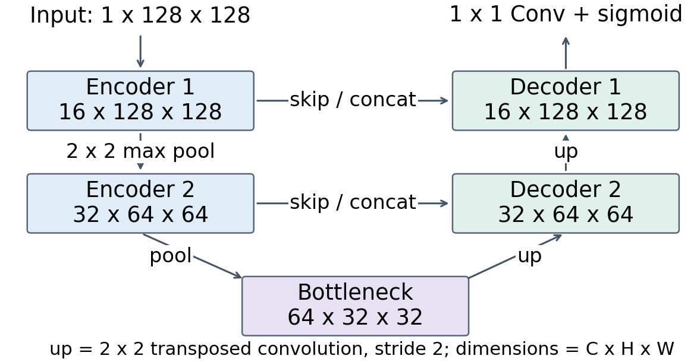
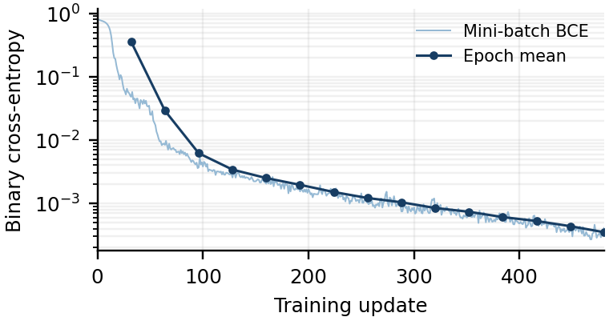
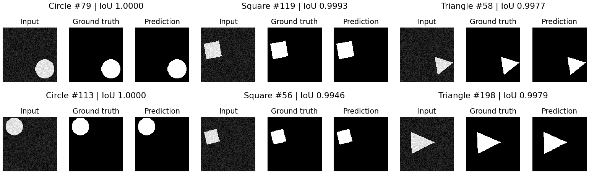

# Assignment 3: U-Net segmentation

Binary pixel segmentation of synthetic circles, squares, and triangles. Author: **Keru Chen**.

## Recorded experiment

- 1,000 training and 200 independently generated test images, each 128 × 128 grayscale.
- Strict binary masks; background intensities 0–55 and foreground 200–255.
- Two-level U-Net, channels 16 → 32 → 64 → 32 → 16, 116,753 parameters.
- Adam, learning rate 0.001, batch size 32, 15 epochs, 480 updates; final checkpoint evaluated once after training.
- Fixed seeds: training data 2026, test data 2027, initialization/shuffle 42, example selection 2028.

| Split | Pixel accuracy | Foreground IoU | BCE |
|---|---:|---:|---:|
| Training | 99.990057% | 0.998548395 | 0.000306169 |
| Test | 99.990173% | 0.998555775 | 0.000303393 |

Test counts: **TP 222,635; TN 3,053,843; FP 226; FN 96**. Counts are pooled over all 3,276,800 pixels. Unweighted mean per-image IoU is 0.998146293. The original run used Python 3.12.14, PyTorch 2.9.0, an Apple M4, and MPS; training took 37.3 seconds, excluding generation and final evaluation. Hardware/backend differences can change training numerics.

The disjoint intensity ranges make a fixed threshold at 128 perfect on this generator. These results establish performance only on the specified synthetic task.

## Reproduce

Python 3.12 is recommended. No external dataset or pretrained model is downloaded.

```bash
python3 -m venv .venv
source .venv/bin/activate
python -m pip install -r requirements.txt
python -m unittest discover -s tests -v
python train.py --device auto
python make_figures.py
```

`auto` chooses CUDA, then MPS, then CPU. For a CPU-only run, use `python train.py --device cpu`. The default output folder is `results`; rerunning training replaces its artifacts. Use `--output results-new` to preserve the recorded run (the plotting script reads `results`).

To evaluate the committed checkpoint without retraining:

```bash
python evaluate.py --device cpu
```

To compile the two-page IEEE report, install a LaTeX distribution providing `IEEEtran` and run:

```bash
cd report
pdflatex -interaction=nonstopmode -halt-on-error report.tex
pdflatex -interaction=nonstopmode -halt-on-error report.tex
```

The report author is Keru Chen. A local `report/author_local.tex` may redefine `\StudentLine` for submission metadata; this file and the locally compiled report PDF are excluded from Git.

## Implementation

- `src/data.py`: size-constrained random geometry, independent splits, and data hashes.
- `src/model.py`: two downsampling stages, two transposed-convolution upsampling stages, and skip concatenations.
- `src/metrics.py`: TP/TN/FP/FN, accuracy, and foreground IoU.
- `train.py`: fixed training schedule, final evaluation, logs, weights, and six seeded test samples.
- `evaluate.py`: checkpoint-only evaluation with test-data hash verification.
- `make_figures.py`: architecture diagram, all-update learning curve, six side-by-side examples, and report metric macros.
- `tests/test_pipeline.py`: data contract, hand-calculated metric counts, and forward/backward checks.
- `results/`: actual run configuration, metrics, CSV logs, model checkpoint, example arrays, and geometry metadata.
- `report/report.tex`: IEEE conference-template report source.

There is no validation-based model selection. The test set is not used for early stopping or threshold selection. Sigmoid probabilities ≥ 0.5 produce the predicted mask. The network returns logits during training for stable `BCEWithLogitsLoss`.







## Reference

O. Ronneberger, P. Fischer, and T. Brox, [U-Net: Convolutional Networks for Biomedical Image Segmentation](https://arxiv.org/abs/1505.04597), MICCAI 2015.
